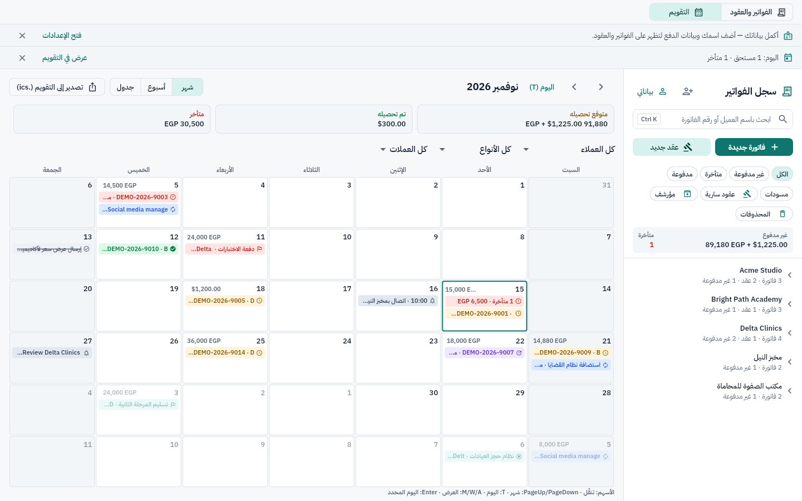

# Invoice Desk

**English.** Invoice Desk is an offline desktop app for freelancers who invoice in Arabic and English. You keep clients, invoices and contracts in one place, edit them with a live preview of the real PDF, and export clean, vector A4 documents. Everything stays on your computer in a single SQLite file, with automatic daily backups. There is no account and no cloud, and the app works fully without a network.

**العربية.** «سجل الفواتير» برنامج مكتبي يعمل بدون إنترنت للمستقلين الذين يصدرون فواتيرهم بالعربية والإنجليزية. تحفظ فيه العملاء والفواتير والعقود في مكان واحد، وتعدّلها مع معاينة حيّة لملف الـ PDF الحقيقي، ثم تصدّر مستندات A4 واضحة. كل البيانات تبقى على جهازك في ملف SQLite واحد مع نسخ احتياطية يومية تلقائية، بلا حساب ولا سحابة.



> **Not an official tax e-invoice.** Invoice Desk produces commercial invoices as PDF. It does not connect to the Egyptian Tax Authority's e-invoicing system (or any other) and does not produce signed e-invoices. Where the law requires those, use the official system.

## Features

- **Invoices.** Bilingual (Arabic/English) and multi-currency (EGP, USD, SAR, AED, EUR).
  - Sections each have their own currency, and lines are one-time, monthly or annual.
  - Optional VAT, plus an optional scope/handover page.
  - Duplicate, renewal (recurring lines only) and mark as paid.
- **Contracts and quotes** from a clause library you maintain (Settings → مكتبة البنود).
  - `{{variables}}` are filled from your profile, the client and the contract. Missing ones are highlighted and block sending.
  - Annex 1 is the scope of work; annex 2 is payments, split by percentage or fixed amount.
  - One click turns a payment milestone into an invoice.
  - Signed contracts are locked; changes go through a numbered amendment (`CT-2026-0003-A1`).
- **Calendar ("التقويم").** Month, week and agenda views of what is due, overdue, paid, postponed, contract payments, renewals, contract dates, warranty ends and your own reminders, all derived from your data.
  - The day panel marks invoices paid, postpones them with a reason (the history is kept), copies a polite payment reminder, and turns milestones and renewals into invoices. Drag a chip to another day to postpone it.
  - A "today" banner says what is due and overdue; an optional desktop notification does the same at start-up.
  - Export to `.ics` for GNOME Calendar or Google Calendar; re-importing updates events instead of duplicating them.
- **Demo data.** A fresh install opens on a fictional demo set dated around today. Settings → البيانات التجريبية removes it (after a backup) or adds it back; anything you edit becomes yours and stays.
- **Live PDF preview** beside the editor on wide windows, with tabs on narrow ones. PDFs are A4 with vector text in IBM Plex Sans Arabic.
- **Search** across clients, phone numbers, invoice and contract numbers, and contract titles. Filters: unpaid, overdue, paid, drafts, contracts in force, archived, and "المحذوفات" (trash).
- **Safe deletes.**
  - Everything goes to "المحذوفات" for 30 days with Undo.
  - Clients with documents are archived rather than deleted, unless you type their name.
  - Permanent deletes write a backup first.
- **Backups.** A daily `VACUUM INTO` copy (the last 30 are kept), plus manual backup and restore in Settings. Backups from older versions restore too.
- **CSV export** for your accountant: one row per invoice, with totals per currency.
- **Two interface languages.** Arabic and English, picked in Settings → General (or followed from the system). The whole app follows the choice, reading direction included: Arabic is right-to-left, English left-to-right.
- **Light and dark themes.** The interface is right-to-left in Arabic and left-to-right in English.

## Install (Linux x86_64)

Download the files from the release page and check them against `SHA256SUMS.txt`:

```bash
sha256sum -c SHA256SUMS.txt --ignore-missing
```

**Fedora / RHEL (RPM).** Installs system-wide in `/opt/invoice-desk`, with a menu entry and the `invoice-desk` command:

```bash
sudo dnf install ./invoice-desk-0.4.0-1.x86_64.rpm
```

```bash
sudo dnf remove invoice-desk   # removes the app only; your data and backups stay
```

**Any distro (tarball).** Installs for your user only, in `~/.local/opt/invoice-desk`, without root:

```bash
tar xzf invoice-desk-0.4.0-linux-x64.tar.gz && ./invoice-desk-0.4.0-linux-x64/install.sh
```

To remove it later, run `./uninstall.sh` from the same folder.

**Any distro (AppImage).** A single file; nothing is installed:

```bash
chmod +x InvoiceDesk-0.4.0-x86_64.AppImage && ./InvoiceDesk-0.4.0-x86_64.AppImage
```

All three need GTK 3, which every mainstream desktop has. Uninstalling never touches your data.

## Build from source

You need Flutter 3.44 (Dart 3.12) and the Linux desktop toolchain (`clang`, `cmake`, `ninja-build`, `pkg-config`, `libgtk-3-dev`).

```bash
flutter pub get
```

```bash
flutter run -d linux
```

```bash
flutter build linux --release
```

The release build lands in `build/linux/x64/release/bundle/`. `./scripts/package_linux.sh` builds the tarball, AppImage, RPM and checksums into `dist/`; it needs `patchelf` and `rpmbuild`. `./scripts/ci_local.sh` runs every CI gate locally. See [docs/RELEASING.md](docs/RELEASING.md) and [docs/TESTING.md](docs/TESTING.md).

## Data and backups

| What | Where |
|---|---|
| Database | `invoice_desk.sqlite` in the app-support folder (Linux: `~/.local/share/me.omarmaarouf.invoice_desk/`) |
| Window size, theme, last open document, last export folder | `ui_state.json` next to the database |
| Daily backups (last 30 kept), `before-delete-…` and `before-purge-…` copies | `backups/` in the data folder, unless changed in Settings |

Set `INVOICE_DESK_DATA_DIR=/some/folder` to move everything above, backups included. It's useful for trying things without touching your real data:

```bash
INVOICE_DESK_DATA_DIR=$(mktemp -d) invoice-desk
```

A new data folder starts with sample data: a profile, one client and one invoice. Edit or delete them as you like.

## Keyboard shortcuts

| Keys | Action |
|---|---|
| Ctrl+N | New invoice |
| Ctrl+Shift+K | New contract |
| Ctrl+Shift+N | New client |
| Ctrl+K / Ctrl+F | Search |
| Ctrl+S | Save now (everything also autosaves) |
| Ctrl+E | Export PDF |
| Ctrl+D | Duplicate |
| Ctrl+R | Renewal invoice (recurring lines only) |
| Ctrl+1 / Ctrl+2 | Edit / preview tab on narrow windows |
| Ctrl+Shift+C | Switch between invoices & contracts and the calendar |
| Calendar: arrows, PageUp/PageDown, T, M/W/A, Enter | Move the day, change month, today, month/week/agenda, open the day panel |
| Esc | Clear search, close dialogs |

In the items table, Tab moves across cells, and Enter in the last price cell adds a row.

## Documentation

- [Architecture](docs/ARCHITECTURE.md): layers, state, data flow, PDFs, and where sync will plug in
- [Data model](docs/DATA_MODEL.md): every table, constraint and trigger, and the migration history
- [Decisions](docs/adr/): ADRs
- [Testing](docs/TESTING.md) · [Releasing](docs/RELEASING.md) · [Contributing](CONTRIBUTING.md) · [Security](SECURITY.md) · [Changelog](CHANGELOG.md)
