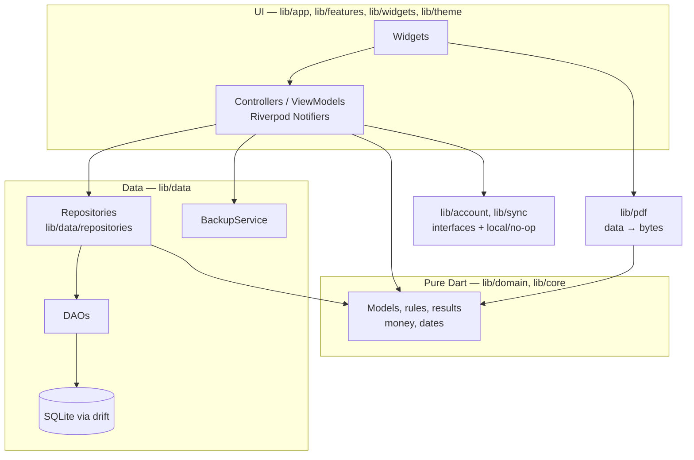
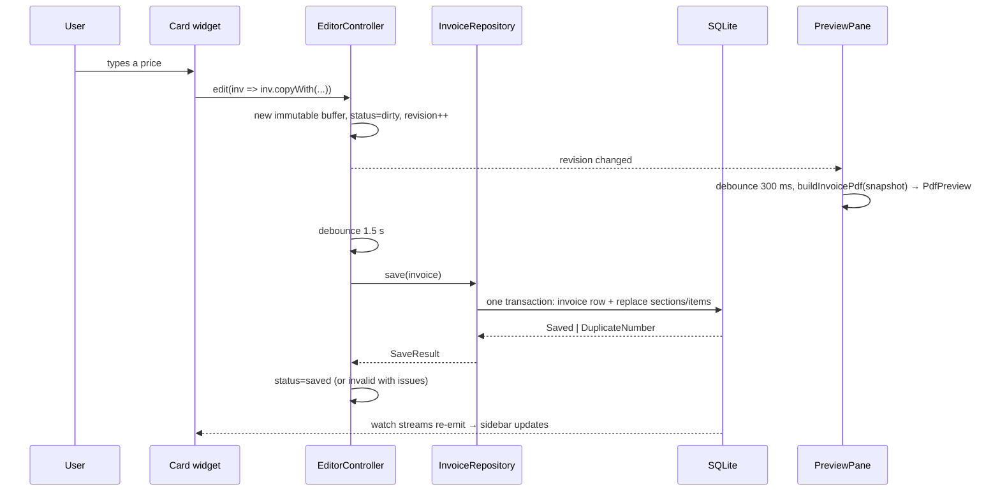
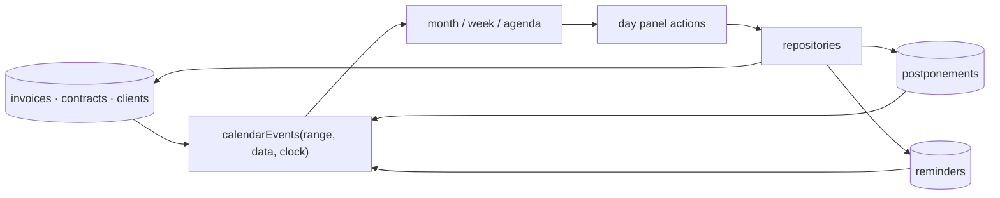
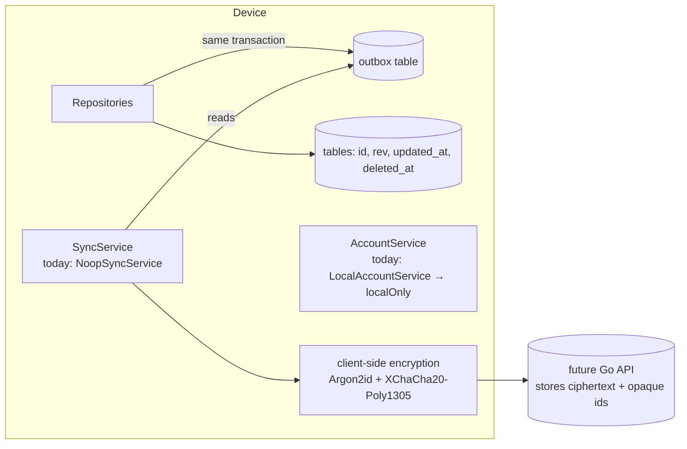

# Architecture

Invoice Desk is a Flutter desktop app, offline-first. It has one SQLite database, no network code, and a UI in Arabic (RTL) and English (LTR) that produces bilingual PDFs. This page explains how the code is laid out and why. The decisions behind it are recorded in [docs/adr/](adr/).

## Layers and the dependency rule



Dependencies point down and inward only:

- **UI** (`lib/app`, `lib/features`, `lib/widgets`) talks to the data layer only through repositories and services, read via the providers in `lib/data/providers.dart`. It never imports `data/daos`, `data/db.dart`, `data/tables.dart` or `package:drift`.
- **Repositories** (`lib/data/repositories/`) wrap the DAOs.
  - They return domain models and typed results (`SaveResult`, `DeleteResult`, `RestoreResult`) instead of DAO exceptions.
  - They run every write under the injected `Clock`.
- **Domain and core** (`lib/domain`, `lib/core`) are pure Dart: no Flutter, no drift. `@immutable` comes from `package:meta`. All the business rules live here (totals, numbering, milestones, variables, validation), so they are unit-tested without a widget tree.
- **PDF** (`lib/pdf`) is a pure function from data to PDF bytes.

The rule is enforced by `test/architecture/layering_test.dart`. Size limits (no hand-written file over 500 lines, no `build` method over 80) are enforced by `tool/check_sizes.dart`. Both run in CI and in `scripts/ci_local.sh`.

## Folder map

```
lib/
  main.dart, bootstrap.dart   window setup, data folder, DB open/migrate, provider overrides,
                              start-up housekeeping (purge + daily backup), DB-error screen
  app/                        app widget, shell (sidebar + workspace), shortcuts (one AppShortcut table),
                              UI providers, ui_prefs, machine_prefs (density, accent, start-up, PDF export)
  core/                       Money/MoneyBag (minor units), CalendarDate, digit folding
  domain/                     models, invoice/contract rules, results, trash, contract_ops
  data/
    tables*.dart, *.drift, db.dart, db.steps.dart   schema + migrations (settings in tables_settings.dart)
    daos/                     drift queries per aggregate
    repositories/             what the UI uses
    providers.dart            DB seam, repositories, live read models
    backup.dart               VACUUM INTO backups, restore, start-up housekeeping
    library_seed.dart, seed.dart   clause library seed, fresh-install seed
    demo_seed.dart            the fictional demo set (dated from the clock, flagged is_demo)
  features/
    sidebar/                  search, filters, client groups, document rows
    editor/                   invoice editor (controller, cards, sections table)
    contracts/                contract editor (controller, cards, actions, preview)
    library/                  clause library editor
    styles/                   تصميم المستندات: style list, live preview, inspector, pickers
    pdf_render.dart           the one place the UI turns a document + its resolved style into PDF bytes
    trash/                    المحذوفات
    calendar/                 التقويم: controller, month/week/agenda views, day panel, banners, actions
    settings/, clients/       settings page, client dialogs
  pdf/                        invoice_pdf + parts, contract_pdf + parts
  account/, sync/             future subscription and sync seams (local/no-op today)
  widgets/, theme/, l10n/     shared widgets, tokens, the Arabic and English strings (ARB)
drift_schemas/                committed schema snapshots, one per version
tool/                         check_sizes, gen_data_model (+ dev helpers)
scripts/                      package_linux.sh, ci_local.sh
```

Large feature UIs are split into `part` files per card (for example `features/contracts/cards/`) so private widgets stay private to their feature.

## State management (Riverpod 3)

| Provider | Owns | Kind |
|---|---|---|
| `databaseProvider`, `appPathsProvider`, `uiPrefsProvider` | Seams overridden in bootstrap and tests | `Provider` (throws unless overridden) |
| `clockProvider` | The one clock for UI dates and data timestamps | `Provider<Clock>` |
| `*RepositoryProvider`, `backupServiceProvider` | Data access | `Provider` |
| `clientsProvider`, `invoicesProvider`, `contractsProvider`, `libraryProvider`, `settingsProvider`, `trashProvider` | Live read models (drift watch streams) | `StreamProvider` |
| `editorProvider` | The open invoice's edit buffer, save status, validation issues, revision | `Notifier<EditorState>` |
| `contractProvider` | The open contract's buffer, lock, missing-variable focus | `Notifier<ContractEditorState>` |
| `openResolverProvider`, `openMissingProvider` | Variable resolution for the open contract | derived `Provider` |
| `sidebarDataProvider` | Filtered, grouped sidebar (pure `buildSidebar`) | derived `Provider` |
| `workspaceProvider`, `previewTabProvider`, `searchQueryProvider`, `sidebarFilterProvider`, `themeModeProvider`, `uiLanguageProvider` | UI state | small `Notifier`s |
| `localeProvider` | The app locale: the UI-language choice resolved against the translated locales (English when the system asks for another language) | derived `Provider` |
| `accountServiceProvider`, `syncServiceProvider` | Future subscription/sync; local and no-op today | `Provider` |

Widgets read with `ref.watch(x.select(...))` for display and `ref.read(x.notifier)` in callbacks. Each editor has one write path: the controller edits an immutable buffer, and a debounced save goes through a repository.

## Data flow: edit invoice → autosave → PDF preview



Switching documents, exporting and closing the window all flush the buffer first. Edits that arrive during a save stay dirty and get their own save.

## Interface language

The UI strings live in ARB files (`lib/l10n/arb/`): `app_ar.arb` is the template and `app_en.arb` follows it key for key. `test/l10n/arb_parity_test.dart` fails when a key, a placeholder or an ICU plural branch is missing in one of them, so a half-translated screen cannot slip through.

- **The choice.** Settings → General picks Arabic, English or the system language; the choice is kept per machine in `uiPrefsProvider` (`uiLanguage`). `localeProvider` resolves it against the locales that actually have translations: a system language the app does not have falls back to English.
- **Live and whole-app.** The choice is a provider, so the locale, the reading direction and every string change at once, without a restart.
- **Direction.** Widgets use `EdgeInsetsDirectional`, `AlignmentDirectional` and `TextDirection`-aware icons. Material mirrors its own directional icons (`chevron_left`, `arrow_back`); the few that exist in a left-to-right and a right-to-left variant are picked with `directionalIcon` (`lib/widgets/common.dart`).
- **The text of a field.** A text field follows its content, not the interface: the first strong character decides the direction, and an empty field follows the interface. The numbers, the codes, the dates and the e-mail addresses keep an explicit direction. `ContentTextField` (`lib/widgets/text_direction.dart`) does it once for every field, and scrolls the field to the start of its text.
- **Dates.** The UI formats dates with the document formatter (`lib/domain/doc_format.dart`) and the UI language, so an English screen shows "14 Nov 2026" and an Arabic one "١٤ نوفمبر ٢٠٢٦".
- **Documents are separate.** The language of a document is not the language of the UI ([ADR 0011](adr/0011-document-language-model.md)).

## Money

Amounts are integer **minor units** (hundredths). Rates are **basis points** (1400 = 14%) with half-up rounding (`applyBasisPoints`). `MoneyBag` keeps totals per currency and never adds across currencies: an invoice with EGP and USD sections shows `22,000 EGP + $255.50`.

Contract milestones split the total by **largest remainder**, so percentages that add up to 100% always add up to the total exactly (`milestoneAmounts`).

## Numbering

- Invoices follow the pattern in Settings → Invoices, `{PREFIX}-{YYYY}-{SEQ:4}` by default (`OM-2026-0001`); tokens `{PREFIX}`, `{YYYY}`, `{YY}`, `{SEQ}`/`{SEQ:n}`. The next sequence is the year's maximum plus one, or the maximum over all years when yearly reset is off, deleted invoices included, so a number is never reused. New documents get their number, year and sequence from `InvoiceRepository.nextNumber`; existing numbers are never rewritten. A pattern that could repeat numbers (no `{SEQ}`, or a yearly reset without a year) is refused in Settings and falls back to the default. A hand-typed free-form number keeps its text and gets an unused sequence.
- Contracts are `CT-…` and quotes `QT-…`, with separate sequences. Amendments reuse the original's series, year and sequence with an `-A<n>` suffix.
- Uniqueness is enforced by the database (`UNIQUE(number)` and composite keys), not only by the UI.

## Soft delete, trash and purge

Deleting sets `deleted_at` (UTC ms) and the row moves to "المحذوفات".

- **Batches.** Rows deleted together share the stamp. Undo, and restore from the trash, bring back exactly that batch.
- **Guards.** Triggers refuse to leave a live document under a deleted client. Hard-deleting a client with any document rows is refused by `ON DELETE RESTRICT`.
- **Purge at start-up.** Housekeeping removes rows deleted more than 30 days ago: contracts, then invoices, then clients nothing references.
- **Manual purge.** "حذف نهائي" and "إفراغ المحذوفات" do the same immediately, after a typed confirmation and a `before-purge-…` backup.

## Backups

`BackupService` checkpoints the WAL, then runs `VACUUM INTO` to a temp file, reopens it to verify the invoice count, and only then renames it into place. A live WAL database is never copied with a file copy.

- **Daily.** At start-up when the last backup is over 24 h old, the last 30 are kept.
- **Before risky actions.** `before-delete-client-…` and `before-purge-…` files are written before those actions and never pruned.
- **Restore.** Restore writes a safety copy first, then replaces the data in one transaction with named columns. That way, backups from older schema versions load into the current one, and a backup without a clause library keeps the current library.

## Migrations

The schema lives in `lib/data/tables.dart` and `lib/data/triggers.drift`, and `currentSchemaVersion` is in `AppDatabase`. A schema change takes these steps:

1. Bump the version.
2. Run `dart run drift_dev make-migrations`. It writes `drift_schemas/app_db/drift_schema_vN.json`, `lib/data/db.steps.dart` and the test helpers.
3. Write the `fromXToY` step.
4. Extend `test/drift/app_db/migration_test.dart` with data.
5. Rehearse on a database created by the previous release (see [TESTING.md](TESTING.md)).

CI fails if the schema changed without a new snapshot. Migrations run inside the app on first open. Nobody backs up by hand: the daily backup and restore's support for older versions are the safety net.

## PDF pipeline

`buildInvoicePdf(InvoicePdfData, PdfFonts)` and `buildContractPdf(ContractPdfData, PdfFonts)` are pure: data in, bytes out.

- **Fonts.** IBM Plex Sans Arabic is bundled and embedded, so all text is vector.
- **Builders.** Each document is assembled by small builder extensions in `lib/pdf/invoice/` and `lib/pdf/contract/` (header, parties, tables, totals, signatures, footer).
- **Look and labels.** Builders read colours and page geometry from a `PdfStyle` (`lib/pdf/pdf_style.dart`; `PdfStyle.classic` is the 0.4 look) and fixed labels from `DocLabels` (`lib/pdf/labels.dart`, Arabic and English). Document text never comes from ARB: a document's language is independent of the UI language ([ADR 0011](adr/0011-document-language-model.md)). Dates, clause headings, currency names and digits come from `lib/domain/doc_format.dart`.
- **Goldens.** `test/pdf/goldens/*.txt` hold each sample document's page content streams, so any layout change shows up as a text diff.
- **Arabic text.** Direction is chosen per run, with the font's normal word spacing. The `pdf` package is vendored with an RTL patch (`third_party/pdf`, [ADR 0013](adr/0013-vendored-pdf-rtl-fix.md)): upstream mirrored words by their ink box, so words ending in ر or ز ran into the next word, and its per-character font fallback reversed Latin tokens inside Arabic lines. Letter spacing is applied to Latin runs only; Arabic runs always use 0 (`test/pdf/arabic_letter_spacing_test.dart`). `test/pdf/rtl_word_gap_test.dart` measures the gaps. A date ending in digits is laid out as two runs so its space survives bidi reordering.
- **Contract variables.** Resolved at render time by `VariableResolver` and never stored resolved; unresolved ones are drawn on an amber background.
- **Preview.** The preview pane re-renders the real PDF 300 ms after the last edit. Previews and exports both go through `lib/features/pdf_render.dart`, which asks `StyleRepository.lookForInvoice/lookForContract` for the resolved style and logo, so what you see is what you export.
- **Issue snapshots.** When a document is committed (sent, paid, signed), `DocumentSnapshots` also freezes what it printed from outside itself: provider block, payment methods, client block, date format, currency display and digit style (`issue_snapshot`, [ADR 0014](adr/0014-issue-snapshots.md)). `pdf_render.dart` overlays `Settings` and `Client` from it before the builders run. Documents committed before v8 have none and render from live data.
- **Formats.** Dates print `long` (`14 Sep 2026`) or `numeric` (`14/09/2026`); amounts print with the currency `code` (today), `local` Arabic symbols in Arabic documents, or `symbol` (`lib/domain/doc_format.dart`). The tax registration number prints with the provider block when set.
- **Styles.** A document's look resolves snapshot → document style → client style → settings default → Classic ([ADR 0012](adr/0012-document-styles.md)). The style editor (`lib/features/styles/`) edits user styles through one `StyleEditorController` that autosaves 600 ms after the last change.

## Calendar

The calendar is a **derived view plus two stored tables**.

- **Derived.** `calendarEvents(range, data, clock)` in `lib/domain/calendar/events.dart` is a pure function: invoices, contracts, clients, postponements and reminders in, a sorted list of events out. Nothing it returns is stored; due, overdue, paid, milestone, renewal, contract and warranty events are recomputed from the documents on every change. Dates are civil dates (`CalendarDate`), so time zones and DST never move an event.
- **Stored.** Only what the documents can't express:
  - `postponements`: a history of moved due dates for invoices and milestones. The latest row is the effective due date, and overdue is measured against it everywhere (sidebar, PDF, calendar). The original due date is never overwritten.
  - `reminders`: manual entries, optionally timed and linked to a client or document.
  Both are sync-ready like every other table (UUID, `rev`, `updated_at`, `deleted_at`, outbox triggers).
- **Rules worth knowing.**
  - A milestone shows until a sent or paid invoice covers it; then the invoice's own event takes over.
  - Recurring items of a paid invoice renew monthly/annually from its issue date until a later invoice of the same client bills the same service as a recurring item.
  - The overdue rollup on today counts every overdue invoice, wherever its date is.
- **Actions** in the day panel go through the same controllers and repositories as the editors (autosave, undo, validation); the calendar never writes to the database itself.
- **Export.** `buildIcs` writes RFC 5545 with stable UIDs (`invoice-due-<id>@invoice-desk.local`, …), so a re-import updates events.



## Demo data

A fresh install gets an empty profile and the demo set from `seedDemo`: five fictional clients (example.com / example.eg addresses, `0100 000 00xx` numbers), fourteen invoices in every state and both currencies, three contracts and reminders, all dated relative to the injected clock. Every demo row has `is_demo = 1` and numbers in a separate `DEMO-…` series (seq 9001+) that real numbering ignores. A user save through a repository clears the flag (the row is adopted). "حذف البيانات التجريبية" writes a `before-remove-demo-…` backup and hard-deletes only `is_demo` rows and what hangs off them; a demo client still used by an adopted document is kept and becomes real.

## Future: encrypted sync

The desktop app is free and complete. A paid subscription will later add **end-to-end encrypted** sync across devices. This release prepares the seams; there is no network code.



- `lib/account/`: `AccountService` with a sealed `AccountState` (`localOnly` today; later `signedIn`, `subscribed`, `expired`). It is wired in bootstrap with `LocalAccountService`. **No feature is ever gated on it.**
- `lib/sync/`: `SyncService` (`push`, `pull`, `status` stream) and `NoopSyncService`. Settings shows "المزامنة السحابية: غير مفعّلة — قريبًا".
- **Sync-ready data** (schema v4):
  - Every syncable row has a UUID id, `updated_at` (UTC ms), a `rev` that increments on every write, and a `deleted_at` tombstone.
  - Settings stores a `device_id`.
  - Each change writes an `outbox` row (`entity`, `row_id`, `rev`, `changed_at`) **in the same transaction**, so a sync engine only has to read the outbox.
- **Encryption design**: [ADR 0010](adr/0010-end-to-end-encrypted-sync.md) (proposed).
- **The rule.** The app is offline-first, and sync is an optional add-on. Sync must never block local use, export or backup. Losing the account or the network never affects local data.
